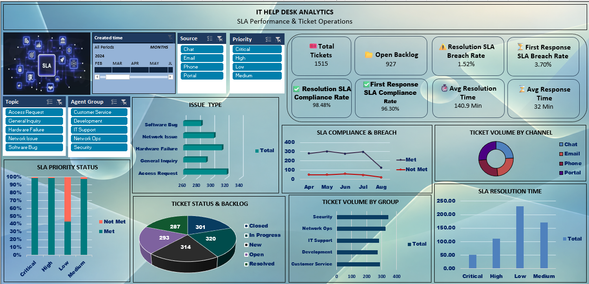

# IT Help Desk SLA Breach Prediction

## Project Overview

The **IT Help Desk SLA Breach Prediction** project focuses on analyzing IT Help Desk ticket data, understanding Service Level Agreement (SLA) performance, identifying factors associated with SLA breaches, and developing a machine learning approach to predict potential SLA breaches.

The project includes two major phases:

1. **Excel Analysis and Dashboard Development**
2. **Machine Learning – SLA Breach Prediction**

The project uses the **Balanced Scenario dataset** for Excel analysis and the **SLA_Breach_Prediction_Prjct.ipynb** notebook for the machine learning phase.

## Project Objectives

- Analyze IT Help Desk ticket data.
- Understand ticket volume and distribution.
- Analyze ticket status, priority, issue types, and agent groups.
- Evaluate First Response SLA and Resolution SLA performance.
- Identify SLA-compliant and SLA-breached tickets.
- Analyze average response and resolution times.
- Identify patterns related to SLA breaches.
- Develop an interactive Excel dashboard.
- Apply machine learning techniques for SLA breach prediction.

## Tools and Technologies Used

| Category | Tools and Technologies |
|---|---|
| Data Analysis | Microsoft Excel, Python |
| Data Manipulation | Pandas, NumPy |
| Data Visualization | Excel Charts, Pivot Charts |
| Dashboard | Microsoft Excel |
| Machine Learning | Scikit-learn |
| Development Environment | Jupyter Notebook / Google Colab |
| Version Control | Git and GitHub |

## Project Workflow

### 1. Excel Analysis and Dashboard Development

**Dataset:** `ITDesk_SLA_Analysis_Scenario_Balanced.xlsx`

The Balanced Scenario dataset was used to analyze IT Help Desk ticket information and understand overall operational performance.

#### Data Analysis

The Excel analysis covers:

- **Ticket Volume Analysis:** Analyzing the overall number of tickets and their distribution.
- **Ticket Status Analysis:** Understanding open, closed, and pending tickets.
- **Priority Analysis:** Comparing ticket volumes and SLA performance across priority levels.
- **Issue Type Analysis:** Identifying the distribution of tickets across different issue categories.
- **Agent Group Analysis:** Understanding ticket distribution among agent groups.
- **Channel Analysis:** Examining tickets received through different channels.

#### SLA Performance Analysis

**First Response SLA Analysis**

Evaluates whether tickets receive their initial response within the defined SLA time.

- First Response SLA compliance.
- First Response SLA breaches.
- Average first response time.

**Resolution SLA Analysis**

Evaluates whether tickets are resolved within the defined SLA time.

- Resolution SLA compliance.
- Resolution SLA breaches.
- Average resolution time.

#### Key Performance Indicators (KPIs)

The Excel dashboard presents the following KPIs:

| KPI | Value |
|---|---:|
| Total Tickets | 1,515 |
| Open Backlog | 927 |
| Resolution SLA Breach Rate | 1.52% |
| First Response SLA Breach Rate | 3.70% |
| Resolution SLA Compliance | 98.48% |
| First Response SLA Compliance | 96.30% |
| Average Resolution Time | 140.9 Minutes |
| Average Response Time | 32 Minutes |

#### Dashboard Visualizations

The interactive Excel dashboard includes:

1. SLA Priority Status
2. Issue Type Distribution
3. SLA Compliance and Breach Analysis
4. Ticket Volume by Channel
5. Ticket Status Analysis
6. Ticket Volume by Agent Group
7. SLA Resolution Time Analysis

#### Interactive Dashboard Filters

The dashboard includes slicers for:

- Created Time
- Source
- Priority
- Topic
- Agent Group

These filters allow users to explore ticket information and SLA performance based on different categories.

### Dashboard Preview



### 2. Machine Learning – SLA Breach Prediction

**Notebook:** `SLA_Breach_Prediction_Prjct.ipynb`

The machine learning phase focuses on applying machine learning techniques to the IT Help Desk ticket data to predict potential SLA breaches.

The notebook contains the implementation of the SLA breach prediction project.

*The specific algorithms, preprocessing steps, model evaluation metrics, and prediction results should be documented here according to the actual notebook implementation.*

## Project Structure

```text
ITHelpDesk_SLA-Breach_Prediction/
│
├── Excel/
│   ├── ITDesk_SLA_Analysis_Scenario_Balanced.xlsx
│   └── Dashboard/
│       └── SLA_Dashboard.png
│
├── Machine_Learning/
│   ├── SLA_Breach_Prediction_Prjct.ipynb
│   └── Vdo/
│       └── SLA_Breach_Prediction_Prjct.ipynb_Compressed.mp4
│
└── README.md
```

## Technologies and Skills Demonstrated

- Data Analysis
- Data Cleaning and Preparation
- Exploratory Data Analysis
- KPI Development
- Excel Pivot Tables and Pivot Charts
- Interactive Dashboard Development
- Python Programming
- Machine Learning
- Data Visualization
- Git and GitHub

## Project Demonstration Video

Watch the **SLA Breach Prediction Project Demonstration**.

## Key Outcomes

- Analyzed 1,515 IT Help Desk tickets using the Balanced Scenario dataset.
- Developed an interactive Excel dashboard to monitor ticket operations and SLA performance.
- Examined First Response SLA and Resolution SLA compliance.
- Identified important ticket performance indicators.
- Worked on a machine learning approach to predict potential SLA breaches.

## Conclusion

This project provides practical experience in IT Help Desk data analysis, SLA performance monitoring, dashboard development, and machine learning.

The Excel phase helps understand ticket operations and SLA performance through data analysis and visualization, while the machine learning phase focuses on predicting potential SLA breaches.
